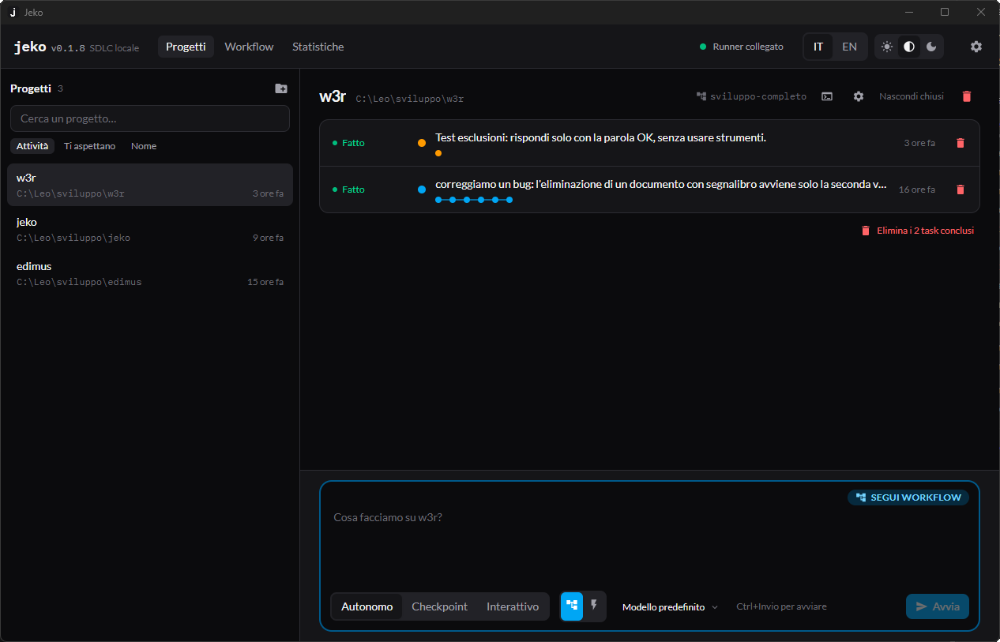

# Jeko

[English](./README.md) · **Italiano**

Tool di SDLC locale e personale: app desktop per Windows ([Neutralino](https://neutralino.js.org)) con un servizio Node che lancia il tuo Agent.

- **Il tuo agente, il tuo PC.** Un ciclo di sviluppo completo che gira tutto in locale con il tuo Agent: niente cloud, niente account, i tuoi progetti restano dove sono.
- **Sempre aggiornato, da solo.** Le nuove versioni arrivano dalle release di GitHub: un clic e Jeko si aggiorna e si riapre.
- **Il lavoro in tasca, a costo zero.** Segui i task dal telefono, rispondi alle domande, approva i gate e lanciane di nuovi ovunque tu sia. Basta inquadrare un QR, i messaggi sono cifrati da un capo all'altro e non serve nessun server a pagamento.
- **Workflow su misura.** Piani, controlli e gate di approvazione in YAML, versionati. Oppure, quando serve, una richiesta libera e via.
- **Decidi tu quanto lasciare fare.** Autonomo, Checkpoint o Interattivo, con modello e impegno dell'Agent scelti per progetto o per singolo task.
- **Progetti nuovi in un attimo.** L'AI li crea da un template e li aggiunge da sola all'elenco.
- **Memoria di progetto.** In `.jeko/` di ogni progetto ci sono descrizione, comandi e note, che i workflow tengono aggiornati.
- **Zero installazione.** Una cartella portabile e un `jeko.exe`: servono solo Node, Git e un Agent (oggi Claude Code).

**Pagina del progetto, con il video dimostrativo:** [leolmi.github.io/jeko/it](https://leolmi.github.io/jeko/it/)

[](https://leolmi.github.io/jeko/it/)

## Pacchetti

| Pacchetto         | Contenuto                                                                                |
| ----------------- | ---------------------------------------------------------------------------------------- |
| `packages/shared` | Contratto e validazione (TypeBox + Ajv)                                                  |
| `packages/server` | Servizio: API Fastify 5, dati su file, runner nello stesso processo, aggiornamenti       |
| `packages/runner` | Motore dei workflow, server MCP e hook dei permessi, lancia `claude` una volta per turno |
| `packages/admin`  | Web-app Angular 22 zoneless, Tailwind 4, Lato e IBM Plex Mono                            |
| `packages/relay`  | Relay per l'accesso remoto, con la pagina remota                                         |
| `desktop/`        | Pagina d'avvio della finestra Neutralino (`resources.neu`)                               |

## Requisiti

Node ≥ 22, Git e un Agent nel PATH (oggi Claude Code). Nient'altro da installare.

## App desktop

Cartella portabile (`release/jeko/`, nessuna installazione):

```
jeko.exe          Neutralino
resources.neu     pagina d'avvio
server/jeko.js    servizio: un solo file (API, runner, server MCP e hook dei permessi)
server/admin/     web-app
server/relay/     pagina remota, per il relay su questo PC
```

- `jeko.exe` avvia il servizio come estensione Neutralino (`node server/jeko.js --desktop`): si stacca dalla finestra, ascolta su `127.0.0.1:4310` e serve la web-app, che la finestra apre appena il servizio risponde.
- Chiusa la finestra, il servizio esce quando non ha task attivi; se ce ne sono, resta acceso finché non finiscono o si fermano a una domanda o a un gate, poi esce. I task fermi riprendono al prossimo avvio. Riaprendo Jeko mentre il servizio è ancora acceso, la finestra usa quello.
- Registro: `%LOCALAPPDATA%\jeko\logs\jeko.log`.
- **Aggiornamenti** (Opzioni → Versione e aggiornamenti; controllo anche all'avvio e ogni 6 ore): l'ultima release GitHub di `leolmi/jeko` ha `manifest.json` e uno zip con exe, `resources.neu` e `server/`. Il servizio scarica lo zip, verifica lo SHA-256, rinomina i file attuali in `*.old`, copia i nuovi e riapre l'app. Solo senza task al lavoro e non dai sorgenti. La prima versione si installa a mano.

## Accesso remoto

Task seguiti e gestiti dal telefono attraverso un relay, con messaggi cifrati e dispositivi collegati col QR. Il relay può girare dentro Jeko ed essere esposto con Tailscale Funnel: vedi **[Accesso remoto](./docs/it/accesso-remoto.md)**.

## Dati

In `%LOCALAPPDATA%\jeko\data` (o `JEKO_DATA_DIR`); per il backup basta copiare la cartella a Jeko chiuso.

```
settings.json             opzioni dell'utente, primo avvio, workflow e template di serie già caricati
projects.json             progetti
templates.json            template per creare i progetti
workflows.json            indice delle versioni dei workflow
workflows/<nome>/<n>.yaml una versione
runs/<id>/run.json        run con stato e richieste all'utente
runs/<id>/events.jsonl    eventi della run
remote.json               accesso remoto: relay, canale, dispositivi collegati
relay/channels.json       relay su questo PC: hash dei token dei canali
```

Il servizio tiene tutto in memoria tranne YAML ed eventi, letti quando servono; ogni scrittura è atomica (file temporaneo, fsync, rinomina). Il runner ha i suoi file in `%LOCALAPPDATA%\jeko\runner` (giornali delle run e turni di claude).

Dalle versioni con PGlite: `npm run migrate:pglite` copia i dati da `%LOCALAPPDATA%\jeko\db` (lasciandolo com'è) a `%LOCALAPPDATA%\jeko\data`.

## Comandi

```sh
npm install
npm run build          # shared → admin → server (dist/jeko.js)
npm test               # Vitest (shared, server, runner, e2e) + test di admin
npm run lint
npm run format
npm run dev:server     # servizio dai sorgenti, http://127.0.0.1:4310
npm run dev:admin      # http://localhost:4200, /api e /ws in proxy sul servizio
npm run dev:desktop    # finestra Neutralino (con dev:server già acceso)
npm run package        # build + neu build + release/jeko e pacchetto di aggiornamento
npm run release        # pubblica il pacchetto come release GitHub v<versione> (GitHub CLI)
```

La versione è quella di `package.json` (da tenere uguale in `neutralino.config.json`). Variabili d'ambiente: vedi `.env.example`.

## Conoscenza del progetto (`.jeko/`)

Alla radice di ogni progetto gestito da Jeko:

- `project.md`: cos'è, stack, convenzioni;
- `commands.yaml`: `nome: comando` senza shell (es. `test: npm test`), usati dai check con `commands: [typecheck, lint, test]`;
- `notes/*.md`: cose imparate lavorando.

Il runner la passa a claude nel primo turno di ogni run. La creazione di un progetto la prepara, i workflow di sviluppo la aggiornano prima della chiusura.

## Progetti e workflow

- I workflow sono solo di sviluppo (`kind: develop`). Ogni progetto ne fissa uno nelle sue opzioni (⚙ accanto al nome), altrimenti vale il predefinito, cioè il primo per nome. Si usa sempre l'ultima versione.
- Nei passi `agent`, `effort` (`low`…`max`) e `model` (es. `opus`) diventano `claude --effort/--model`. Esempio: `sviluppo-completo.yaml`.
- I progetti nuovi li crea l'AI, partendo da un template, cioè un prompt già pronto con un nome, che si gestisce in "Nuovo progetto". Nel prompt valgono `{{ name }}`, `{{ dir }}` e `{{ request }}`. Al termine il progetto entra da solo nell'elenco.
