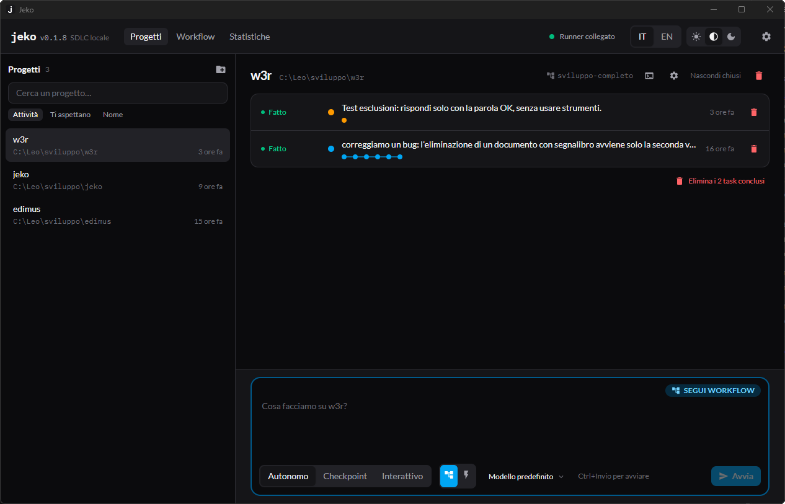

# Jeko

**English** · [Italiano](./README.it.md)

A local, personal SDLC tool: a desktop app for Windows, Linux and macOS (preview) ([Neutralino](https://neutralino.js.org)) with a Node service that runs your Agent.

- **Your agent, your PC.** A complete development cycle that runs entirely on your machine with your own Agent: no cloud, no account, your projects stay where they are.
- **Always up to date, on its own.** New versions come from GitHub releases: one click and Jeko updates and restarts.
- **Your work in your pocket, at zero cost.** Follow tasks from your phone, answer questions, approve gates and start new ones wherever you are. Just scan a QR code: messages are end-to-end encrypted and no paid server is needed.
- **Workflows made to measure.** Plans, checks and approval gates in YAML, versioned. Or, when that's all you need, a free request and off it goes.
- **You decide how much to let go.** Autonomous, Checkpoint or Interactive, with the Agent's model and effort chosen per project or per task.
- **New projects in no time.** The AI creates them from a template and adds them to the list by itself.
- **Project memory.** Each project's `.jeko/` holds its description, commands and notes, kept up to date by the workflows.
- **Zero installation.** A portable folder and a `jeko.exe`: all you need is Node, Git and an Agent (currently Claude Code).

**Project page, with the demo video:** [leolmi.github.io/jeko](https://leolmi.github.io/jeko/)

[](https://leolmi.github.io/jeko/)

## Packages

| Package           | Contents                                                                      |
| ----------------- | ----------------------------------------------------------------------------- |
| `packages/shared` | Contract and validation (TypeBox + Ajv)                                       |
| `packages/server` | Service: Fastify 5 API, file-based data, in-process runner, updates           |
| `packages/runner` | Workflow engine, MCP server and permission hooks, runs `claude` once per turn |
| `packages/admin`  | Angular 22 zoneless web app, Tailwind 4, Lato and IBM Plex Mono               |
| `packages/relay`  | Relay for remote access, with the remote page                                 |
| `desktop/`        | Startup page of the Neutralino window (`resources.neu`)                       |

## Requirements

Node ≥ 22, Git and an Agent on the PATH (currently Claude Code). Nothing else to install.

## Desktop app

Portable folder (`release/jeko/`, no installation):

```
jeko.exe          Neutralino
resources.neu     startup page
server/jeko.js    service: a single file (API, runner, MCP server and permission hooks)
server/admin/     web app
server/relay/     remote page, for the relay on this PC
```

- `jeko.exe` starts the service as a Neutralino extension (`node server/jeko.js --desktop`): it detaches from the window, listens on `127.0.0.1:4310` and serves the web app, which the window opens as soon as the service responds.
- Once the window is closed, the service exits when it has no active tasks; if there are some, it stays on until they finish or stop at a question or a gate, then exits. Paused tasks resume at the next start. Reopening Jeko while the service is still running, the window uses it.
- Log: `%LOCALAPPDATA%\jeko\logs\jeko.log`.
- **Updates** (Options → Version and updates; also checked at startup and every 6 hours): the latest GitHub release of `leolmi/jeko` has `manifest.json` and a zip with the exe, `resources.neu` and `server/`. The service downloads the zip, checks its SHA-256, renames the current files to `*.old`, copies the new ones and restarts the app. Only with no tasks at work, and not when running from source. The first version is installed by hand.

### Linux and macOS (preview)

```sh
curl -fsSL https://github.com/leolmi/jeko/releases/latest/download/install.sh | sh
```

The script checks Node, Git and claude, downloads the package for the system (`linux-x64`, `linux-arm64`, `mac-universal`), checks its SHA-256 and installs it in `~/.local/share/jeko/app` (Linux, with a menu entry) or `~/Library/Application Support/jeko/app` (macOS, with `~/Applications/Jeko.app`). After that it updates itself like on Windows. Data and log sit beside it (`…/jeko/data`, `…/jeko/logs`). The service starts with `server/service.sh`, which takes the PATH from the login shell when node, git or claude are missing (apps opened from the desktop don't have it). On Linux the window needs WebKitGTK, and the folder dialog needs `zenity` or `kdialog`. macOS has never been tried on a real Mac.

## Remote access

Tasks followed and managed from your phone through a relay, with encrypted messages and devices paired with a QR code. The relay can run inside Jeko and be exposed with Tailscale Funnel: see **[Remote access](./docs/remote-access.md)**.

## Data

In `%LOCALAPPDATA%\jeko\data` (or `JEKO_DATA_DIR`); to back it up, just copy the folder while Jeko is closed.

```
settings.json             user options, first start, built-in workflows and templates already loaded
projects.json             projects
templates.json            templates for creating projects
workflows.json            index of workflow versions
workflows/<name>/<n>.yaml one version
runs/<id>/run.json        run with its state and questions to the user
runs/<id>/events.jsonl    run events
remote.json               remote access: relay, channel, paired devices
relay/channels.json       relay on this PC: hashes of the channel tokens
```

The service keeps everything in memory except YAML and events, which are read when needed; every write is atomic (temporary file, fsync, rename). The runner keeps its own files in `%LOCALAPPDATA%\jeko\runner` (run journals and claude turns).

From the PGlite versions: `npm run migrate:pglite` copies the data from `%LOCALAPPDATA%\jeko\db` (leaving it as it is) to `%LOCALAPPDATA%\jeko\data`.

## Commands

```sh
npm install
npm run build          # shared → admin → server (dist/jeko.js)
npm test               # Vitest (shared, server, runner, e2e) + admin tests
npm run lint
npm run format
npm run dev:server     # service from source, http://127.0.0.1:4310
npm run dev:admin      # http://localhost:4200, /api and /ws proxied to the service
npm run dev:desktop    # Neutralino window (with dev:server already running)
npm run package        # build + neu build + release/jeko and update package
npm run release        # publishes the package as GitHub release v<version> (GitHub CLI)
```

The version is the one in `package.json` (keep it the same in `neutralino.config.json`). Environment variables: see `.env.example`.

## Project knowledge (`.jeko/`)

At the root of every project managed by Jeko:

- `project.md`: what it is, stack, conventions;
- `commands.yaml`: `name: command` without a shell (e.g. `test: npm test`), used by checks with `commands: [typecheck, lint, test]`;
- `notes/*.md`: things learned while working.

The runner passes it to claude in the first turn of every run. Creating a project prepares it; the development workflows update it before closing.

## Projects and workflows

- Workflows are development-only (`kind: develop`). Each project pins one in its options (⚙ next to the name), otherwise the default applies, i.e. the first by name. The latest version is always used.
- In `agent` steps, `effort` (`low`…`max`) and `model` (e.g. `opus`) become `claude --effort/--model`. Example: `sviluppo-completo.yaml`.
- New projects are created by the AI, starting from a template, i.e. a ready-made prompt with a name, managed in "New project". The prompt can use `{{ name }}`, `{{ dir }}` and `{{ request }}`. When done, the project joins the list by itself.
