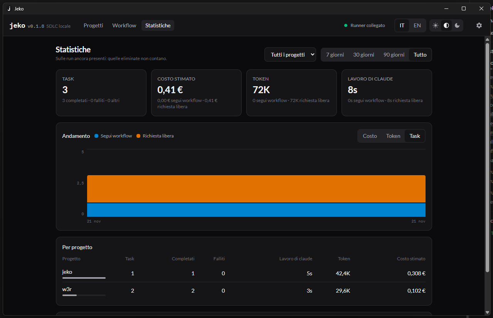

Jeko è un'app desktop per Windows che gestisce i tuoi progetti e ci lavora sopra con **Claude Code**, seguendo workflow di sviluppo che scegli tu. Tutto resta sul tuo computer: niente cloud, niente account.

[Scarica l'ultima versione](https://github.com/leolmi/jeko/releases/latest)

<video src="./jeko-demo.webm" poster="./jeko-progetti.png" controls muted playsinline style="width:100%"></video>

## Cosa fa

- **Progetti**: l'elenco dei progetti seguiti, ognuno con il suo workflow, modello e impegno di Claude.
- **Workflow**: passi di sviluppo in YAML (agenti, controlli, gate di approvazione), versionati.
- **Run**: Claude lavora un turno alla volta; quando serve ti fa una domanda o si ferma a un gate e aspetta.
- **Nuovi progetti**: li crea l'AI partendo da un template, poi entrano da soli nell'elenco.
- **Conoscenza del progetto**: in `.jeko/` di ogni progetto (descrizione, comandi, note), aggiornata dai workflow.
- **Accesso remoto**: segui e gestisci i task dal telefono, con messaggi cifrati ([come si configura](./accesso-remoto.html)).
- **Aggiornamenti automatici** dalle release di GitHub.

## Installazione

1. Servono **Node ≥ 22**, **Git** e **Claude Code** nel PATH.
2. Scarica lo zip dall'[ultima release](https://github.com/leolmi/jeko/releases/latest) ed estrailo in una cartella.
3. Avvia `jeko.exe`. Non c'è nient'altro da installare.

Le versioni successive arrivano da sole (Opzioni → Versione e aggiornamenti).

## Dati

Stanno in `%LOCALAPPDATA%\jeko\data`. Per il backup basta copiare la cartella a Jeko chiuso.

## Per sviluppatori

Pacchetti, comandi e struttura sono nel [README](https://github.com/leolmi/jeko#readme).
