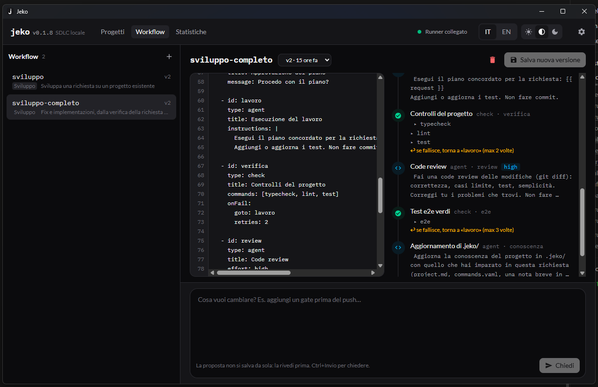

**English** · [Italiano](./it/)

Jeko is a Windows desktop app that manages your projects and works on them with your **Agent** (currently Claude Code), following development workflows of your choice. Everything stays on your computer: no cloud, no account.

[Download the latest version](https://github.com/leolmi/jeko/releases/latest)

<video src="./jeko-demo.webm" poster="./jeko-progetti.png" controls muted playsinline style="width:100%"></video>

## What it does

- **Projects**: the list of projects you follow, each with its own workflow and the Agent's model and effort.
- **Workflows**: development steps in YAML (agents, checks, approval gates), versioned.
- **Runs**: the Agent works one turn at a time; when needed it asks you a question or stops at a gate and waits.
- **New projects**: the AI creates them from a template, then they join the list by themselves.
- **Project knowledge**: in each project's `.jeko/` (description, commands, notes), kept up to date by the workflows.
- **Remote access**: follow and manage tasks from your phone, with encrypted messages ([how to set it up](./remote-access.html)).
- **Automatic updates** from GitHub releases.

## Installation

1. You need **Node ≥ 22**, **Git** and an **Agent** on the PATH (currently Claude Code).
2. Download the zip from the [latest release](https://github.com/leolmi/jeko/releases/latest) and extract it to a folder.
3. Run `jeko.exe`. There is nothing else to install.

Later versions arrive on their own (Options → Version and updates).

## Data

It lives in `%LOCALAPPDATA%\jeko\data`. To back it up, just copy the folder while Jeko is closed.

## For developers

Packages, commands and structure are in the [README](https://github.com/leolmi/jeko#readme).
